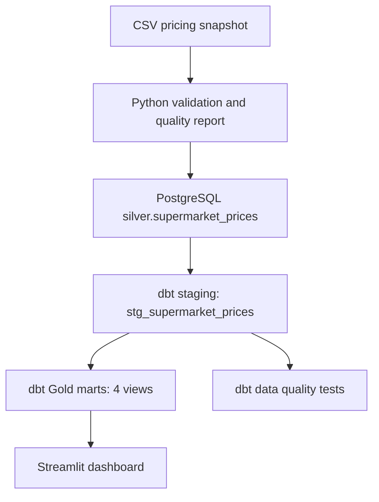

# Supermarket Price Intelligence Pipeline — v2 (dbt)

A Data Engineering portfolio project that validates a supermarket pricing CSV snapshot, loads it into PostgreSQL, transforms it with **dbt Core**, runs data quality tests, and serves analytics through a Streamlit dashboard.

> **Scope:** Educational price analytics using advertised product listings from Coles, Woolworths, and Aldi. Listings are not matched across retailers. This is not a real-time shopping or price-history service.

## Architecture



**Stack:** Python, pandas, SQLAlchemy, PostgreSQL, dbt Core, dbt-postgres, SQL, Streamlit and Plotly.

## Warehouse models and grain

| Model | Grain and purpose |
|---|---|
| `stg_supermarket_prices` | One row per `combined_product_id`; price quality flags |
| `mart_price_comparison` | One row per priced listing; no product matching across retailers |
| `mart_promotion_summary` | One row per supermarket; promotion aggregates |
| `mart_cheapest_unit_products` | One row per listing with a unit price; **not** a cheapest winner per category |
| `mart_data_quality_summary` | One row per supermarket; missing/invalid field counts |

The `dbt/models/schema.yml` file defines **six generic column tests**; `dbt/tests/assert_current_price_nonnegative.sql` adds **one singular SQL test**. Total: **7 tests**.

### Local verification results

A user-supplied local verification run reported:

| Check | Result |
|---|---:|
| PostgreSQL Silver records | **15,344** |
| dbt models | **5/5 successful** |
| dbt tests | **7/7 passed**, none skipped |
| `gold.mart_price_comparison` | 15,344 rows |
| `gold.mart_cheapest_unit_products` | 13,057 rows |
| `gold.mart_promotion_summary` | 3 rows |
| `gold.mart_data_quality_summary` | 3 rows |

These are **saved local-run results**, not a CI guarantee. Generated dbt logs, target artifacts, local credentials, and virtual environments are intentionally excluded from Git.

## Run locally

Requires Python 3.11+, PostgreSQL and a database user with schema/table creation permissions. No Docker Compose configuration is included.

```powershell
git clone https://github.com/AnTran289/supermarket-price-pipeline.git
cd supermarket-price-pipeline
python -m venv .venv
.\.venv\Scripts\Activate.ps1
python -m pip install -r requirements.txt
Copy-Item .env.example .env
```

Update `.env` with `DB_USER`, `DB_PASSWORD`, `DB_HOST`, `DB_PORT` and `DB_NAME`. Do not commit credentials. The source snapshot is `data/silver/supermarket_prices_silver.csv`.

```powershell
python src/run_pipeline.py
python -m streamlit run dashboard/app.py
```

The runner validates the CSV, ensures the PostgreSQL Silver schema/table exist, replaces snapshot rows **inside a single database transaction**, and executes `dbt build` (models plus tests). It does not retain historical snapshots. Existing dependent relations are preserved instead of using `DROP TABLE CASCADE`.

To run dbt independently, first load the `.env` values into your shell:

```powershell
dbt debug --project-dir dbt --profiles-dir dbt
dbt build --project-dir dbt --profiles-dir dbt
```

## Data quality and interpretation

- Python validation checks required columns, missing and duplicate IDs, missing names/prices, and retailer values. It writes a local report to `data/quality_reports/`.
- dbt checks key staging fields, accepted retailer values and nonnegative current prices.
- Unit-price listings must be compared only within compatible units and product categories; **the current mart does not normalize or match equivalent products**.
- The older `sql/03_create_gold_views.sql` is retained as a v1 reference. The v2 pipeline uses dbt Gold marts.

## Future improvements

Product normalization/matching, historical price snapshots, reproducible PostgreSQL integration tests, and CI-based dbt verification.

## Author

**An Tran** — Data Engineering portfolio project.
