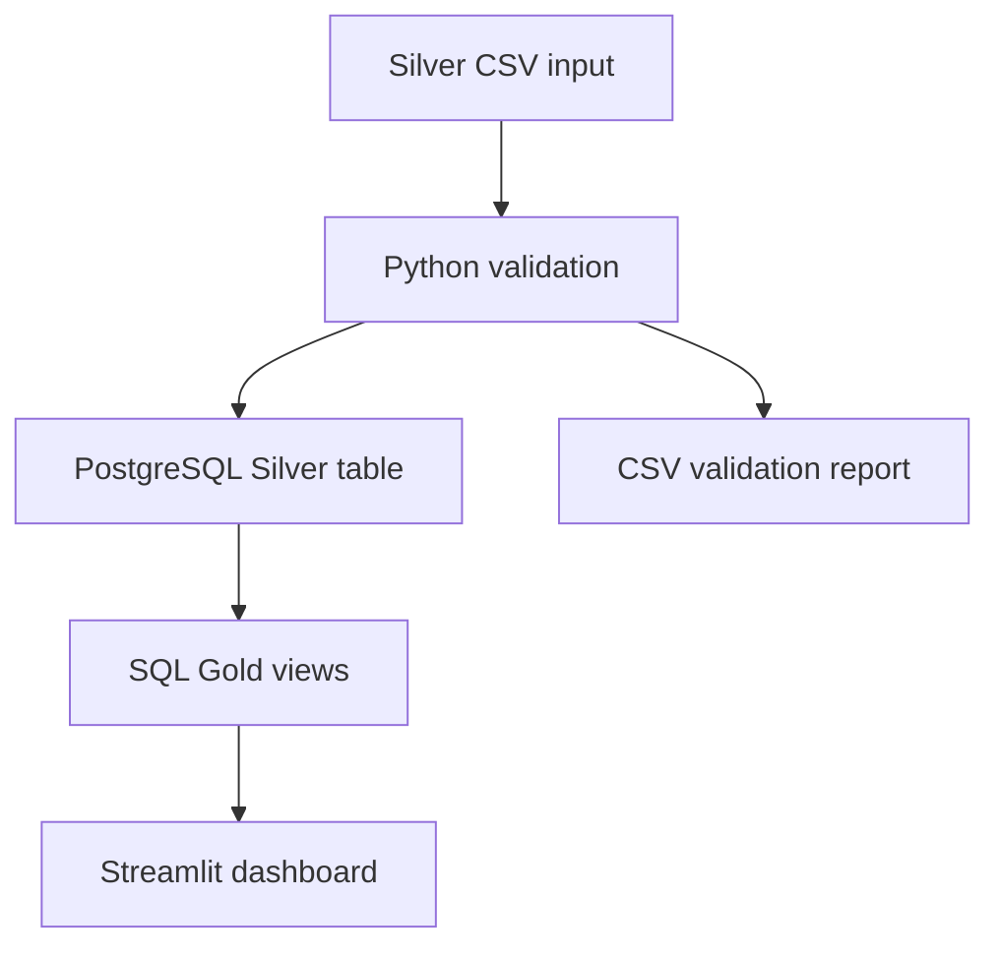

# Supermarket Price Intelligence Pipeline

A local Data Engineering portfolio project that processes supermarket product pricing data from **Coles**, **Woolworths**, and **Aldi**.

The project loads cleaned supermarket price data into **PostgreSQL**, creates analytics-ready **Gold views**, and powers a **Streamlit dashboard** for product price comparison, promotion tracking, unit price analysis, and data quality monitoring.

---

## Project Objective

The goal of this project is to build a small but realistic data pipeline that demonstrates core Data Engineering skills:

* Data ingestion from CSV
* Data validation and quality checks
* PostgreSQL database loading
* Silver and Gold data modelling
* SQL-based analytical transformations
* Dashboard reporting with Streamlit
* Reproducible local pipeline execution

---

## Architecture

**Published implementation:** Python CSV validation and loading → PostgreSQL Silver table → SQL Gold views → Streamlit. A dbt extension is described as future work, but dbt project files are not currently published in this repository.



The pipeline follows a simplified medallion architecture:

```text
Silver Layer:
Cleaned and structured supermarket product data

Gold Layer:
Business-ready views for dashboard and analysis
```

---

## Tech Stack

| Tool       | Purpose                               |
| ---------- | ------------------------------------- |
| Python     | Pipeline scripting and CSV validation |
| Pandas     | CSV processing and validation         |
| PostgreSQL | Database storage                      |
| pgAdmin    | PostgreSQL database management        |
| Docker     | Local PostgreSQL container            |
| SQLAlchemy | Python-to-PostgreSQL connection       |
| Streamlit  | Interactive dashboard                 |
| Plotly     | Data visualisation                    |
| dotenv     | Environment variable management       |

---

## Dataset

The dataset contains supermarket product pricing data from:

* Coles
* Woolworths
* Aldi

Main columns include:

| Column                | Description                           |
| --------------------- | ------------------------------------- |
| `combined_product_id` | Global unique product row ID          |
| `retailer_product_id` | Product ID from the original retailer |
| `product_name`        | Product name                          |
| `brand`               | Product brand                         |
| `pack_size`           | Product package size                  |
| `current_price`       | Current listed price                  |
| `unit_price`          | Price per unit                        |
| `unit_quantity`       | Unit quantity                         |
| `unit_type`           | Unit type such as kg, g, L, ml, ea    |
| `is_on_promotion`     | Promotion flag                        |
| `save_amount`         | Amount saved during promotion         |
| `was_price`           | Previous price before promotion       |
| `supermarket`         | Retailer name                         |

---

### Note on Product Brand

In the current version, `product_name` is treated as the primary product title. Some product names already include the brand inside the product title. The `brand` column is optional and partially populated, depending on the source retailer data.

Brand extraction and brand standardisation are planned as future improvements.

---

## Project Structure

```text
supermarket-price-pipeline/
│
├── dashboard/
│   └── app.py
│
├── data/
│   ├── silver/
│   │   └── supermarket_prices_silver.csv
│   └── quality_reports/
│       └── validation_report.csv
│
├── sql/
│   ├── 01_create_schemas.sql
│   ├── 02_create_silver_table.sql
│   └── 03_create_gold_views.sql
│
├── src/
│   ├── validate_csv.py
│   ├── load_csv_to_postgres.py
│   └── run_pipeline.py
│
├── .env  # create locally; ignored by Git
├── requirements.txt
└── README.md
```

---

## Database Design

### Silver Layer

The Silver table stores cleaned product-level supermarket data.

```text
silver.supermarket_prices
```

This table contains cleaned product names, prices, unit prices, promotion information, and supermarket source information.

### Gold Layer

The Gold layer contains analytical views used by the dashboard.

| Gold View                     | Purpose                          |
| ----------------------------- | -------------------------------- |
| `gold.price_comparison`       | Product-level price comparison   |
| `gold.promotion_summary`      | Promotion summary by supermarket |
| `gold.cheapest_unit_products` | Cheapest products by unit price  |
| `gold.data_quality_summary`   | Data quality issue summary       |

---

## Data Quality Checks

The validation script checks for:

* Missing required columns
* Null `combined_product_id`
* Duplicate `combined_product_id`
* Missing `product_name`
* Missing `current_price`
* Invalid supermarket names
* Missing `unit_price`
* Invalid promotion rows where `was_price < current_price`

Validation output is saved to:

```text
data/quality_reports/validation_report.csv
```

---

## How to Run the Project Locally

### 1. Clone the repository

```bash
git clone https://github.com/AnTran289/supermarket-price-pipeline.git
cd supermarket-price-pipeline
```

### 2. Install dependencies

```bash
pip install -r requirements.txt
```

### 3. Start PostgreSQL with Docker

Make sure your PostgreSQL Docker container is running.

This repository does not currently include a Docker Compose configuration. Start a PostgreSQL instance locally or with your own Docker setup, then configure its connection details in `.env`.

### 4. Configure database connection

Create a `.env` file:

```env
DB_USER=postgres
DB_PASSWORD=your_password_here
DB_HOST=localhost
DB_PORT=5432
DB_NAME=postgres
```

Update the password or database name if your local PostgreSQL setup is different.

### 5. Run the pipeline

The runner expects `data/silver/supermarket_prices_silver.csv` to exist locally. If this file is absent, supply your own CSV with the documented columns. **Note:** the loader currently uses `if_exists="append"`; rerunning it may duplicate data or fail on a uniqueness constraint. The pipeline is not yet idempotent.


```bash
python src/run_pipeline.py
```

This command will:

```text
1. Validate the CSV file
2. Create PostgreSQL schemas
3. Create the Silver table
4. Load the CSV into PostgreSQL
5. Create Gold views
```

### 6. Run the Streamlit dashboard

```bash
streamlit run dashboard/app.py
```

Then open:

```text
http://localhost:8501
```

---

## Dashboard Features

The Streamlit dashboard includes:

* Total product count
* Product count by supermarket
* Promotion percentage by supermarket
* Searchable product table
* Cheapest products by unit price
* Data quality summary
* Supermarket-level comparison

---

## Example Business Questions Answered

This project can help answer questions such as:

* Which supermarket has the most listed products?
* Which supermarket has the highest promotion percentage?
* Which products are cheapest by unit price?
* Which rows have missing unit price data?
* Which products have invalid promotion pricing?
* How do Coles, Woolworths, and Aldi compare by product pricing?

---

## Screenshots

### Dashboard Overview


### Price Comparison


### Unit Price Analysis


### Promotion Analysis


### Data Quality


### Silver Data Explorer


---

## Current Pipeline Status

Completed:

* Cleaned and combined supermarket CSV data
* Created global product IDs
* Loaded data into PostgreSQL
* Created Silver table
* Created Gold analytical views
* Built Streamlit dashboard
* Added CSV validation script
* Added automated pipeline runner

---

## Future Improvements

Potential future upgrades:

* Publish a runnable dbt project for SQL transformations and testing
* Make repeated loads idempotent
* Add a reproducible PostgreSQL Docker Compose configuration
* Add Airflow for orchestration
* Add product matching across supermarkets
* Add basket cost comparison
* Add category classification
* Add Power BI dashboard as a business reporting layer
* Add cloud warehouse support using Snowflake
* Deploy the dashboard online
* Add scheduled scraping or automated data refresh

---

## Key Learning Outcomes

This project demonstrates practical Data Engineering skills including:

* Building a reproducible pipeline
* Designing Silver and Gold data layers
* Loading data into PostgreSQL
* Writing SQL analytical views
* Performing data validation
* Connecting dashboards to database views
* Structuring a project for GitHub portfolio use

---

## dbt Extension — Not Included in This Repository

A dbt-based extension has been explored, but this public repository does not currently contain the dbt project files, models, or tests needed to reproduce it. The documented, published implementation uses the SQL Gold views in `sql/03_create_gold_views.sql`.

---

## Author

Quoc Van Khanh An Tran (An Tran)
Data Engineering / Data Analytics Portfolio Project
